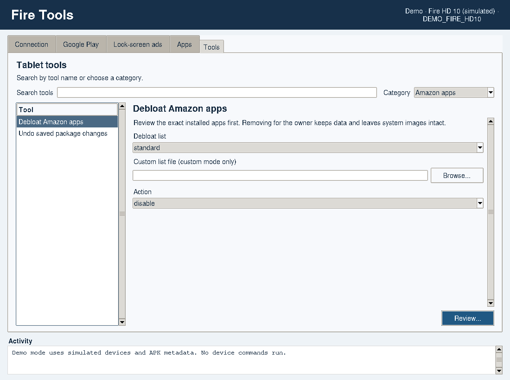

# Fire Tools

An independent, MIT-licensed desktop and command-line toolkit for Amazon Fire tablets. Version 0.3 adds the Google sync adapters, Fire Toolbox v46 debloat lists and combined lock-screen ad controls. It also includes launcher and keyboard controls, backups, file transfers, screen capture and wireless ADB.

This release is designed for Fire tablets running Android API 23 or later. Device changes require the primary adult (owner) profile. Compatibility on a physical tablet, including the Fire HD 10, remains unverified.

## Checking your download

Fire Tools runs from Python source on your computer. Use the launcher included in this repository with an installed copy of Python. The source distribution includes the optional Android helper as Java code. Google apps are separate downloads.

**Before connecting the tablet**, open **Google Play → Choose APKs → Check scan records**. This reads the files locally and shows whether their SHA-256 hashes match files examined in the project audit. The command-line equivalent is `./launch-linux.sh check-apks file.apk` or `.\launch-windows.cmd check-apks "C:\Downloads\file.apk"` in PowerShell. For Google components, use the **Google Play** tab. It checks Google’s signing identity and verifies the installed bytes. The general **sideload** tool also accepts apps from other publishers. [Links to the six scanned builds](docs/GOOGLE-APKS.md#files-with-a-local-scan-record) · [Audit and scan results](docs/TESTING.md)

## The three main workflows

| Goal | Where to find it | What it does |
| --- | --- | --- |
| Install Google Play | **Google Play** | Verifies locally selected Google components against the pinned Google signing certificate, checks compatibility and installs them in dependency order. |
| Debloat Amazon apps | **Apps → Debloat presets** or **Tools → Amazon apps** | Standard, complete or custom package lists; disable or remove for the owner; preview the exact installed targets; save prior states for undo. Core infrastructure is protected. |
| Disable lock-screen ads | **Lock-screen ads** | Temporary setting, Special Offers package disable/restore, or optional [source-built helper](companion/README.md). All depend on firmware; no mode guarantees that ads disappear. |

Removing a system package for the owner does not erase its read-only system image. Restoring it uses the existing package image; a removed third-party app may need its original APK. Debloat previews disclose skipped packages and potential dependencies. Do not select an app you still need.

## More tools

The searchable **Tools** tab exposes installed-app inventory, batch app controls, verified standalone APK sideloading, system-app update/rollback, launcher and keyboard selection, permissions, app operations, settings editing and undo, privacy/display/sound options, configuration backups, APK extraction, file copy, screenshots, recording, logs, profiles, power and connection utilities.

The command line uses the same catalog:

```sh
python -m open_fire_toolkit tools
python -m open_fire_toolkit tools --feature debloat
python -m open_fire_toolkit --demo tool debloat --serial DEMO_FIRE_HD10 --param profile=standard
python -m open_fire_toolkit tool source-catalog
```

For a real tablet, put the tool paths before `tool`, include `--serial` from `devices`, and provide the listed `--param key=value` arguments. Mutations default to preview. Review the preview and repeat the command with its printed `--yes --confirm-token TOKEN` arguments. Each token binds the tablet, inputs, targets and state shown by that plan. Source links and Wi-Fi endpoint connection do not require a selected tablet; connecting does not automatically select it.

See [feature coverage and remaining differences](docs/FEATURES.md), [original Toolbox comparison](docs/PARITY-RESEARCH.md), and [verification](docs/TESTING.md). **This is not a verified drop-in replacement for every Fire Toolbox 46 option.** The original's privileged exploits, several companion-assisted workarounds, automatic version-selected APK downloads, split APK bundle installation and some device-profile options are not reproduced. A settings-page shortcut is labeled as a shortcut, not as successful device configuration.

## Try the offline demo

Extract the source ZIP. From the extracted directory, run the command for your platform. The demo uses a fictional tablet and sample APK names. It needs no tablet, Android tools, or APK files.

| Windows | Linux |
| --- | --- |
| `launch-windows.cmd gui --demo` | `./launch-linux.sh gui --demo` |

In PowerShell, prefix the Windows launcher with `.\`. You can also run `python -m open_fire_toolkit gui --demo` using your Python 3.11+ interpreter. On Linux the interpreter is typically named `python3`. Start the regular interface by running the launcher with no arguments.



## Set up a real tablet

1. Install Python 3.11 or later. For the GUI use a Python installation with Tk support. The official Windows installer includes an optional Tcl/Tk component. On Debian or Ubuntu, install `python3-tk` for the distribution's Python. The CLI does not require Tk. [Python downloads](https://www.python.org/downloads/)
2. Download Google's SDK Platform-Tools and extract the entire archive. For Google Play, also install Android SDK Build Tools using the SDK Manager in Android Studio or Google's SDK command-line tools. Use a JDK compatible with your chosen tools. JDK 17 or newer is a practical starting point. The Build Tools 36.0.0 verifier launched with OpenJDK 21 in a local smoke check. Android Studio's bundled runtime is also an option. The toolkit leaves tool and APK downloads to you. [Platform-Tools](https://developer.android.com/tools/releases/platform-tools) · [SDK Manager](https://developer.android.com/studio/command-line/sdkmanager) · [Build Tools](https://developer.android.com/tools/releases/build-tools)
3. On the tablet, open **Settings → Device Options → About Fire Tablet**, tap **Serial Number** seven times, then enable USB debugging under **Developer Options**. Names can vary with Fire OS. Connect a USB data cable, unlock the tablet and approve your computer’s RSA fingerprint in the debugging prompt.
4. In **Connection**, supply the full ADB executable path, choose **Scan devices**, select your tablet, and choose **Use selected tablet**. The view shows its Android API level and supported ABIs. If it reports `unauthorized`, check the prompt on the unlocked tablet. If nothing appears, try a data-capable cable and check your operating system's ADB driver or USB permissions. [Android USB setup](https://developer.android.com/studio/run/device)

| GUI field | Windows example | Linux example |
| --- | --- | --- |
| ADB | `C:\Android\platform-tools\adb.exe` | `/home/you/Android/Sdk/platform-tools/adb` |
| AAPT | `C:\Android\Sdk\build-tools\36.0.0\aapt.exe` | `/home/you/Android/Sdk/build-tools/36.0.0/aapt` |
| APK signer | `C:\Android\Sdk\build-tools\36.0.0\lib\apksigner.jar` | `/home/you/Android/Sdk/build-tools/36.0.0/lib/apksigner.jar` |
| Java | `%JAVA_HOME%\bin\java.exe` | `$JAVA_HOME/bin/java` |

Substitute your installed SDK version and browse to the actual Java executable in the GUI. To check that your Java can load the signer, run `java -jar /path/to/lib/apksigner.jar version` with the Java executable you plan to select. If using Android Studio's runtime, its Java executable is in the installation's `jbr/bin` directory. ADB alone covers diagnostics, ads, apps and reboot. Google Play verification needs all four paths. [apksigner documentation](https://developer.android.com/tools/apksigner)

## Install Google Play

Start with the **[Google APK download and verification guide](docs/GOOGLE-APKS.md)**. It links individual standalone APKs for the 2023 Fire HD 10 (Fire OS 8, Android 11) and gives each listing’s package ID, Android requirement and published file SHA-256. You can also look up the links in **Tools → FOSS and app source directory**, even before connecting a tablet. Match the API and processor architectures shown in **Connection**.

| Select for installation | Google components |
| --- | --- |
| Core files | Google Services Framework, Google Play services, Google Play Store |
| Additional login component used by the v46 Android 11 bundle | Google Account Manager |
| Optional account sync | Google Calendar Sync, Google Contacts Sync |

1. On the **Google Play** tab, choose the files and review the install plan. The toolkit checks APK structure, package IDs, minimum Android API level, ABI compatibility and signatures. It verifies Google’s signing certificate for the selected Android API. For Play services it also recognizes the verified signing-key rotation found in v46’s Android 11 package. Signer verification establishes signing identity. APK behavior and compatibility with Fire OS still depend on the selected release. [AndroidX certificate reference](https://android.googlesource.com/platform/frameworks/support/+/7be3a623dfcf461ff6e2004799ac2e652c8d23a8)
2. Confirm the plan for the displayed tablet. The toolkit rechecks the tablet and verifies the privately staged copies before installation. Installation targets Android user 0 and uses Android’s replace mode to preserve existing app data when updating a package. Installation stops at the first failure and reports completed packages. Earlier successful installs remain in place.
3. After a successful install, use **Review reboot** in **Connection** if you want the toolkit to restart the tablet. Then open Play Store on the tablet and sign in there. Amazon does not officially support Google Play on Fire OS. Some apps, sign-in flows, or notifications may fail.

## Lock-screen ads and optional apps

For official Special Offers removal, open **Lock-screen ads** and choose **Open Amazon device settings**. Select your Fire tablet and follow Amazon's paid removal process where available. [Amazon device settings](https://www.amazon.com/mycd)

The basic experimental option writes `LOCKSCREEN_AD_ENABLED=0` once. The firmware may ignore the value or reset it. The toolkit saves the prior value locally before writing and can restore it, including deleting the setting if it was originally absent. Keep the local undo file until you have finished experimenting. [Security and local state](SECURITY.md)

Package mode disables or enables `com.amazon.kindle.kso` and confirms its package state. Firmware may protect it. The optional **Fire Tools Ads Helper** is original Java source, built locally with official Android tools. It needs Android API 24 or later and an explicit secure-settings permission grant. Its visible foreground service reapplies the setting and can stop or restore the original value. Build, verify and install it using the [helper guide](companion/README.md); use the printed signer fingerprint in the desktop helper setup. The helper's setting readback still does not establish actual ad visibility.

To try the v46 package method, open **Lock-screen ads → Suppress with setting and package**. Fire Tools saves both originals, writes the global setting and disables Special Offers for the owner. **Undo setting and package** restores its exact prior package mode and setting, including an originally absent setting. A refused package change can leave the setting changed. Use the same undo after a partial result. If the helper is monitoring the setting, stop or restore it on the tablet first.

For the **Fire HD 10 (13th generation)**, Amazon’s downloadable update page listed **Fire OS 8.3.3.8** on November 27, 2026. Fire Toolbox v46 treats Fire OS 8 builds above 8.3.3.7 as restricted and uses a fallback. On that firmware the package method may be refused and the setting may reset. The official Special Offers removal option is the reliable choice where available. Installing Google APKs is a separate operation. Store sign-in and ad visibility on this firmware still need a physical tablet test. [Amazon software updates](https://digprjsurvey.amazon.com/csad/help/node/G2JXLC4L34GX73TE) · [v46 behavior and XDA sources](docs/PARITY-RESEARCH.md#xda-setup-and-download-provenance) · [REA findings](docs/REA-NOTES.md#suppressing-and-restoring-lock-screen-offers)

**Apps → Debloat presets** offers v46’s **Standard** (22 package IDs) and **Complete** (35). Review which packages are installed and which are protected. Complete skips Amazon Device Setup. Choose **custom** to import a Toolbox `.debloat` file. The default **auto** action follows `ListType=debloat` (disable) or `ListType=restore` (enable). **Tools → Undo saved package changes** restores the states recorded before your batch. The older Fire Tools selections remain available as `standard-v0.2` and `complete-v0.2`.

The **Apps** tab retains quick controls for common Amazon apps and links to the full inventory and debloat tools. The full package picker supports multiple targets. Disabling leaves the package and its data on the tablet. Package undo retains the recorded target states even when a batch stops partway through; read its preview before restoring.

## CLI examples

The examples use Linux paths. On Windows, use `py -3 -m open_fire_toolkit` and quoted Windows paths. Put tool options before the subcommand. Replace `TABLET_SERIAL` with the exact serial from `devices`.

```bash
python3 -m open_fire_toolkit --help
python3 -m open_fire_toolkit --adb /path/to/adb devices
python3 -m open_fire_toolkit --adb /path/to/adb info --serial TABLET_SERIAL
python3 -m open_fire_toolkit --adb /path/to/adb ads --serial TABLET_SERIAL
python3 -m open_fire_toolkit --adb /path/to/adb ads --serial TABLET_SERIAL --restore
python3 -m open_fire_toolkit --adb /path/to/adb ads --serial TABLET_SERIAL --with-package
python3 -m open_fire_toolkit --adb /path/to/adb ads --serial TABLET_SERIAL --with-package --restore
python3 -m open_fire_toolkit --adb /path/to/adb apps --serial TABLET_SERIAL --disabled-only
python3 -m open_fire_toolkit --adb /path/to/adb reboot --serial TABLET_SERIAL
python3 -m open_fire_toolkit --adb /path/to/adb --aapt /path/to/aapt \
  --apksigner-jar /path/to/lib/apksigner.jar --java /path/to/bin/java \
  play --serial TABLET_SERIAL framework.apk play-services.apk play-store.apk
```

The change commands above preview their actions. To apply an action you reviewed, repeat the command with `--yes --confirm-token TOKEN` after its subcommand, using the token printed by that preview. If any reviewed input changes, run a fresh preview. To preview disabling an allowed app, use `apps --serial TABLET_SERIAL --disable com.amazon.mp3`. Use `--enable` to re-enable it.

## Project notes

The source distribution uses the Python standard library and has no runtime PyPI dependencies. See [security and local state](SECURITY.md), [testing](docs/TESTING.md), [REA behavior research](docs/REA-NOTES.md) and the [MIT license](LICENSE).
